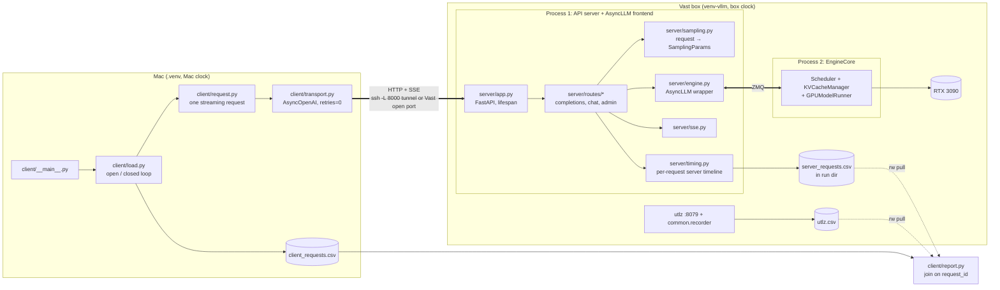
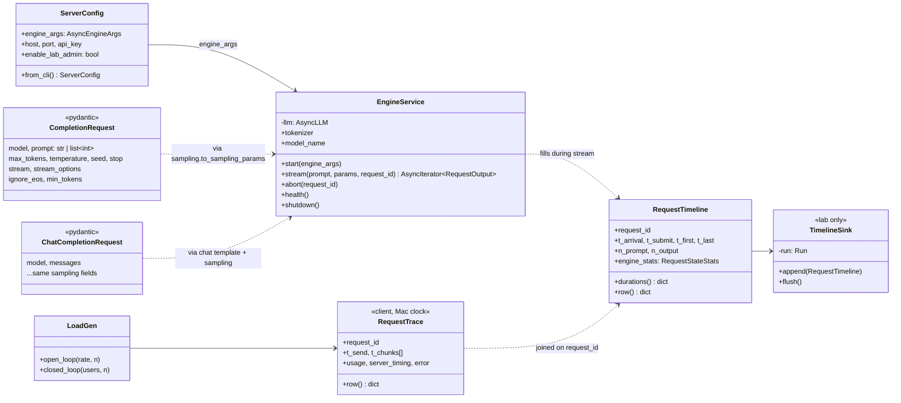
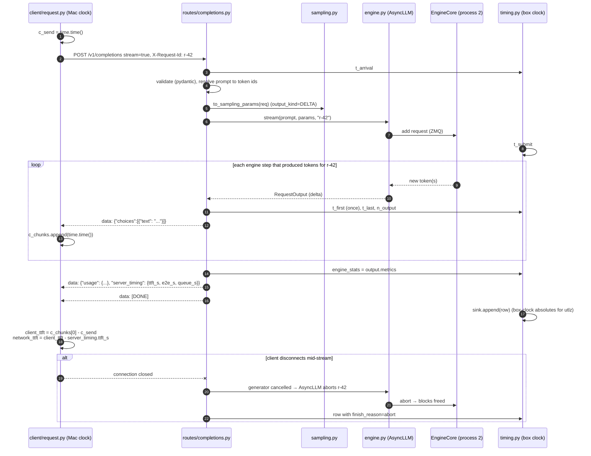
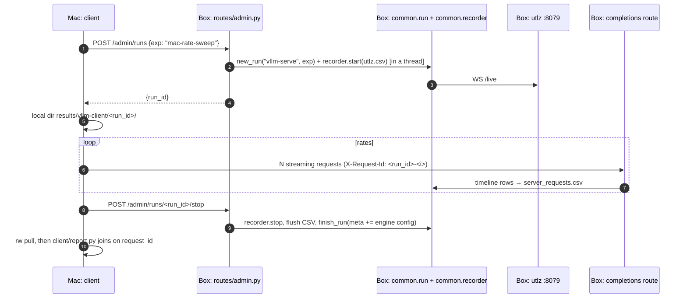

# Phase 2 design: Mac client → vLLM server on Vast

What this doc is: **where each piece of code lives, what it's responsible for, what it must
NOT do, and which official vLLM example or source file it's derived from.** Skeletons only:
plumbing is filled in, and the parts that teach you something are `TODO(you)`.

What it isn't: an intro to vLLM internals (see `phase2-vllm-primer.md` §1) or networking
(primer §1.8.1, "Reaching a vLLM server over the network").

All vLLM references are to the local checkout at `utlz-lab/vllm/` (main, `61f084b5f3`).
Paths are relative to it: `examples/...` and `vllm/...`.

---

## 1. The flow in one picture



Four design decisions drive everything else:

1. **You write a thin server on `AsyncLLM`, not `vllm serve`.** It starts from
   `examples/applications/api_server/server.py` and you add the OpenAI layer yourself.
   That's the exercise. `vllm serve` stays as the reference you diff against and the
   baseline for the "is my server slower?" check.
2. **The Mac never needs the box's clock.** The server measures its own timeline and
   sends back **durations** (not timestamps) in the last SSE chunk. Durations are safe to
   compare across machines, timestamps aren't. Client TTFT − server TTFT = the network's
   share. Absolute box-clock timestamps go to `server_requests.csv` for lining up with utlz.
3. **One request ID end to end.** The client makes it (`X-Request-Id` header), the server
   uses it as the engine `request_id` and logs it, and the report joins on it.
4. **Lab-only controls are isolated.** Start/stop of a measurement run (run dir + utlz
   recorder) is in `routes/admin.py`, off unless `--enable-lab-admin` is set, so the
   serving path stays clean.

---

## 2. Layout

```
utlz-lab/
├── server/                         runs on the Vast box, /workspace/venv-vllm
│   ├── __main__.py                 python -m server --model ... (args → config → run)
│   ├── config.py                   ServerConfig = AsyncEngineArgs + host/port/api-key/lab flags
│   ├── app.py                      FastAPI factory, lifespan: build/shutdown engine, mount routes
│   ├── engine.py                   EngineService: owns AsyncLLM, generate/abort/tokenizer/health
│   ├── protocol.py                 pydantic: CompletionRequest, ChatCompletionRequest, chunks, Usage
│   ├── sampling.py                 protocol request → vllm.SamplingParams (one function)
│   ├── sse.py                      "data: {json}\n\n" framing, [DONE], error event
│   ├── timing.py                   RequestTimeline (box clock) + CSV sink for the active run
│   └── routes/
│       ├── completions.py          POST /v1/completions
│       ├── chat.py                 POST /v1/chat/completions
│       └── admin.py                /health, /metrics, /v1/models, /admin/runs (lab only)
├── client/                         runs on the Mac, utlz-lab/.venv
│   ├── __main__.py                 CLI: one-shot chat, or a load test
│   ├── config.py                   ClientConfig: base_url, api_key, model, out dir
│   ├── transport.py                AsyncOpenAI + raw httpx (for admin routes)
│   ├── request.py                  one streaming request → RequestTrace (Mac clock)
│   ├── load.py                     open-loop Poisson / closed-loop users
│   └── report.py                   join client + server CSVs → TTFT/ITL/network split
├── common/                         existing: run.py, recorder.py, workload.py (from the primer)
└── runway-descriptors/p2_server.toml
```

Rule of thumb for "where does this go?": if it touches `AsyncLLM`, it lives in
`server/engine.py`. If it knows about HTTP/JSON shapes, it's `protocol.py` + `routes/`.
If it knows about the Mac clock, it's `client/`. Nothing else crosses those lines.

---

## 3. What lives where

| Responsibility | Lives in | Must NOT live there | Derived from (example) | Read in vLLM source |
|---|---|---|---|---|
| CLI flags = engine flags + server flags | `server/config.py` | engine construction | `examples/applications/api_server/server.py` (`__main__`: `FlexibleArgumentParser`, `AsyncEngineArgs.add_cli_args`) | `vllm/engine/arg_utils.py` (`AsyncEngineArgs`) |
| Build/shutdown the engine once per process | `server/app.py` lifespan → `server/engine.py` | per-request logic | `api_server/server.py` (`init_app`), `examples/deployment/async_llm_streaming.py` (`AsyncLLM.from_engine_args`, `shutdown`) | `vllm/v1/engine/async_llm.py` (`from_engine_args`, `shutdown`, `check_health`) |
| Submit a request, stream outputs, abort | `server/engine.py` | HTTP, JSON, SSE | `async_llm_streaming.py` (`RequestOutputKind.DELTA` loop) | `async_llm.py` `generate()` (note: cancelling its iterator calls `abort()` for you), `output_processor.py` |
| Request/response JSON shapes | `server/protocol.py` | sampling logic, engine calls | none in `examples/`, it's the OpenAI spec | `vllm/entrypoints/openai/chat_completion/protocol.py`, `completion/` |
| Map request fields → `SamplingParams` | `server/sampling.py` | validation of HTTP shapes | `api_server/server.py` (`SamplingParams(**request_dict)`, the naive version) | `vllm/sampling_params.py` (`ignore_eos`, `min_tokens`, `output_kind`, `seed`, `stop`) |
| Chat messages → prompt (chat template) | `routes/chat.py` via `engine.tokenizer` | the completions route | `examples/basic/offline_inference/chat.py` (what `LLM.chat` does) | `chat_completion/serving.py` (how production renders) |
| SSE framing | `server/sse.py` | anything else | `api_server/server.py` (`StreamingResponse`, but newline-JSON, not SSE) | `chat_completion/serving.py` (the `data:` / `[DONE]` generator) |
| Client disconnect → abort | `routes/*` (decorator) + `engine.py` | client | `api_server/server.py` (`@with_cancellation`) | `vllm/entrypoints/serve/utils/api_utils.py` (`with_cancellation`) |
| Server-side per-request timeline | `server/timing.py` | the client | `examples/observability/metrics/offline.py` (engine-side stats) | `vllm/v1/metrics/stats.py` (`RequestStateStats`: `arrival_time`, `queued_ts`, `scheduled_ts`, `first_token_ts`) |
| `/metrics` (Prometheus) | `routes/admin.py` | your own counters (reuse vLLM's) | `examples/observability/prometheus_grafana/` | `vllm/entrypoints/serve/instrumentator/metrics.py` (`attach_router`), `vllm/v1/metrics/prometheus.py` |
| Run dir + utlz recorder (lab) | `routes/admin.py` → `common/run.py`, `common/recorder.py` | the serving path | your Phase 1 harness | none (this is yours) |
| One streaming request, Mac-clock timestamps | `client/request.py` | load shaping, reporting | `examples/basic/online_serving/openai_completion_client.py` | `vllm/benchmarks/lib/endpoint_request_func.py` |
| Arrival process (open/closed loop) | `client/load.py` | per-token parsing | `examples/generate/batched_chat_completions_online.py` | `vllm/benchmarks/serve.py` (request-rate generator, goodput) |
| Join + percentiles + network split | `client/report.py` | network I/O | none | `vllm/benchmarks/serve.py` (metric calculation) |
| KV-event shadow index (later, rung 5) | `server/kv_index.py` (new file then) | the request path | `examples/features/kv_events/kv_events_subscriber.py` | `vllm/distributed/kv_events.py`, `vllm/v1/core/block_pool.py` (`take_events`) |

---

## 4. LLD



### One request, end to end



### One measurement session (Mac drives, box records)



---

## 5. Skeletons

Order to fill them in: `config` → `engine` → `sampling` + `protocol` (completions only) →
`sse` → `routes/completions` → `app` + `__main__` → **test with the `openai` SDK** →
`client/request` → `timing` → `routes/admin` → `client/load` + `report` → `routes/chat`.

### Box side

#### `server/config.py`
```python
"""CLI → ServerConfig. Derived from examples/applications/api_server/server.py (__main__)."""
from __future__ import annotations

from dataclasses import dataclass

from vllm.engine.arg_utils import AsyncEngineArgs
from vllm.utils.argparse_utils import FlexibleArgumentParser


@dataclass
class ServerConfig:
    engine_args: AsyncEngineArgs
    host: str = "127.0.0.1"          # tunnel-only by default; 0.0.0.0 for a Vast open port
    port: int = 8000
    api_key: str | None = None       # REQUIRED if host is 0.0.0.0
    enable_lab_admin: bool = False   # /admin/runs (run dir + utlz recorder)
    served_model_name: str | None = None

    @classmethod
    def from_cli(cls, argv: list[str] | None = None) -> "ServerConfig":
        p = FlexibleArgumentParser(description="utlz-lab vLLM server")
        p.add_argument("--host", default="127.0.0.1")
        p.add_argument("--port", type=int, default=8000)
        p.add_argument("--api-key", default=None)
        p.add_argument("--enable-lab-admin", action="store_true")
        p = AsyncEngineArgs.add_cli_args(p)          # every engine flag, same names as `vllm serve`
        a = p.parse_args(argv)
        # TODO(you): refuse to start if host == "0.0.0.0" and api_key is None.
        return cls(
            engine_args=AsyncEngineArgs.from_cli_args(a),
            host=a.host, port=a.port, api_key=a.api_key,
            enable_lab_admin=a.enable_lab_admin,
            # --served-model-name may parse to str or list[str] (see arg_utils.py)
            served_model_name=(a.served_model_name[0] if isinstance(a.served_model_name, list)
                               else a.served_model_name),
        )
```

#### `server/engine.py`
```python
"""The ONLY module that touches AsyncLLM.
Derived from examples/deployment/async_llm_streaming.py. Read: vllm/v1/engine/async_llm.py.
"""
from __future__ import annotations

from collections.abc import AsyncIterator

from vllm import SamplingParams
from vllm.engine.arg_utils import AsyncEngineArgs
from vllm.outputs import RequestOutput
from vllm.v1.engine.async_llm import AsyncLLM


class EngineService:
    def __init__(self) -> None:
        self.llm: AsyncLLM | None = None
        self.tokenizer = None
        self.model_name: str = ""

    def start(self, engine_args: AsyncEngineArgs, served_name: str | None = None) -> None:
        # Spawns the EngineCore process, loads weights, profiles memory, sizes KV,
        # captures CUDA graphs. Takes minutes; /health must report not-ready until done.
        self.llm = AsyncLLM.from_engine_args(engine_args)
        self.tokenizer = self.llm.get_tokenizer()
        self.model_name = served_name or engine_args.model

    async def stream(self, prompt, params: SamplingParams, request_id: str) -> AsyncIterator[RequestOutput]:
        """Yield RequestOutputs as the engine produces them.
        If the consumer stops iterating (client gone), AsyncLLM.generate catches the
        CancelledError/GeneratorExit and aborts the request: KV blocks are freed.
        TODO(you): confirm that in async_llm.py generate() (the except block), then test it
        by killing a client mid-stream and watching num_requests_running drop.
        """
        assert self.llm is not None
        async for out in self.llm.generate(prompt, params, request_id):
            yield out

    async def abort(self, request_id: str) -> None:
        assert self.llm is not None
        await self.llm.abort(request_id)

    async def health(self) -> bool:
        # TODO(you): llm.check_health() raises if EngineCore died. Map that to True/False.
        ...

    def shutdown(self) -> None:
        if self.llm is not None:
            self.llm.shutdown()
```

#### `server/protocol.py`
```python
"""OpenAI wire shapes. A deliberately SMALL subset. Write it yourself, then diff against
vllm/entrypoints/openai/completion/ and chat_completion/protocol.py and list what you left out.
"""
from __future__ import annotations

from typing import Literal

from pydantic import BaseModel, Field


class StreamOptions(BaseModel):
    include_usage: bool = False


class SamplingFields(BaseModel):
    max_tokens: int = 16
    temperature: float = 1.0
    top_p: float = 1.0
    seed: int | None = None
    stop: list[str] | str | None = None
    stream: bool = False
    stream_options: StreamOptions | None = None
    # vLLM extensions (outside the OpenAI spec)
    ignore_eos: bool = False
    min_tokens: int = 0


class CompletionRequest(SamplingFields):
    model: str
    prompt: str | list[int]          # token ids accepted: Phase 1-comparable ISL


class ChatMessage(BaseModel):
    role: Literal["system", "user", "assistant"]
    content: str


class ChatCompletionRequest(SamplingFields):
    model: str
    messages: list[ChatMessage]


class Usage(BaseModel):
    prompt_tokens: int
    completion_tokens: int
    total_tokens: int


# TODO(you): response + chunk models:
#   CompletionResponse / CompletionChunk  (object="text_completion", choices[].text, finish_reason)
#   ChatCompletionResponse / ChatCompletionChunk (object="chat.completion.chunk", choices[].delta.content)
#   ErrorResponse  ({"error": {"message", "type", "code"}}): what shape does the openai SDK expect
#   so it raises a proper APIError on your 400s?
# Lab extension, sent only in the final chunk: server_timing: dict[str, float] | None = None
```

#### `server/sampling.py`
```python
"""protocol request → SamplingParams. One function, no HTTP.
Naive version: examples/applications/api_server/server.py (SamplingParams(**request_dict)).
Read: vllm/sampling_params.py.
"""
from __future__ import annotations

from vllm import SamplingParams
from vllm.sampling_params import RequestOutputKind

from server.protocol import SamplingFields


def to_sampling_params(req: SamplingFields) -> SamplingParams:
    # TODO(you): map every field. Decide and comment:
    #   - output_kind: DELTA when streaming (you emit only new text), FINAL_ONLY otherwise.
    #     What does CUMULATIVE (the default) cost you on a 512-token stream?
    #   - stop: str | list → list
    #   - temperature == 0: what does vLLM do with top_p then?
    ...
```

#### `server/sse.py`
```python
"""Server-Sent Events framing. The whole OpenAI streaming protocol is these three functions."""
from __future__ import annotations

import json

from pydantic import BaseModel


def event(payload: BaseModel | dict) -> str:
    body = payload.model_dump_json(exclude_none=True) if isinstance(payload, BaseModel) else json.dumps(payload)
    return f"data: {body}\n\n"


def done() -> str:
    return "data: [DONE]\n\n"


def error(message: str, code: int = 500) -> str:
    # TODO(you): an error that happens AFTER streaming has started can't change the HTTP status
    #   (already sent 200). How does the client find out? Check what chat_completion/serving.py does.
    ...
```

#### `server/timing.py`
```python
"""Server-side per-request timeline on the BOX clock.
Durations go back to the client (cross-machine safe). Absolutes go to CSV (line up with utlz.csv).
Read: vllm/v1/metrics/stats.py RequestStateStats (arrival_time is wall clock; queued_ts,
scheduled_ts, first_token_ts are engine-core monotonic: subtract, never mix with time.time()).
"""
from __future__ import annotations

import time
from dataclasses import dataclass, field


@dataclass
class RequestTimeline:
    request_id: str
    t_arrival: float = field(default_factory=time.time)   # handler entry
    t_submit: float | None = None                          # before engine.stream()
    t_first: float | None = None                           # first non-empty delta
    t_last: float | None = None
    n_prompt: int = 0
    n_output: int = 0
    finish_reason: str | None = None
    engine_stats: object | None = None                     # RequestOutput.metrics on the last output

    def durations(self) -> dict[str, float]:
        # TODO(you): ttft_s, e2e_s, and from engine_stats: queue_s (scheduled - queued),
        #   engine_ttft_s (first_token - queued). Is RequestOutput.metrics populated in your
        #   setup? (It depends on stats logging; check on the box, don't assume.)
        ...

    def row(self) -> dict:
        # TODO(you): flat dict for server_requests.csv: absolutes + durations
        ...


class TimelineSink:
    """Appends rows to <run dir>/server_requests.csv while a lab run is active. No-op otherwise."""
    def __init__(self) -> None:
        self.run = None
        self._rows: list[dict] = []

    def append(self, tl: RequestTimeline) -> None:
        if self.run is not None:
            self._rows.append(tl.row())

    # TODO(you): flush() writes CSV. Called from admin stop, via asyncio.to_thread (never block the loop).
```

#### `server/routes/completions.py`
```python
"""POST /v1/completions. Derived from api_server/server.py (_generate);
production version: vllm/entrypoints/openai/completion/ (serving + protocol).
"""
from __future__ import annotations

import time

from fastapi import APIRouter, Request
from fastapi.responses import JSONResponse, StreamingResponse
from vllm.entrypoints.serve.utils.api_utils import with_cancellation

from server import sse
from server.protocol import CompletionRequest
from server.sampling import to_sampling_params
from server.timing import RequestTimeline

router = APIRouter()


@router.post("/v1/completions")
@with_cancellation
async def completions(req: CompletionRequest, raw: Request):
    engine = raw.app.state.engine          # EngineService
    sink = raw.app.state.timeline_sink
    request_id = raw.headers.get("x-request-id") or ...   # TODO(you): generate one if missing
    tl = RequestTimeline(request_id)

    # TODO(you): validate model name == engine.model_name (404-style error otherwise)
    # TODO(you): prompt: list[int] → pass as {"prompt_token_ids": ...}; str → pass as-is.
    #   Set tl.n_prompt. Reject prompts longer than max_model_len BEFORE submitting. Why here
    #   and not in the engine? (Hint: what HTTP status would the client get otherwise?)
    params = to_sampling_params(req)
    prompt = ...

    async def gen():
        tl.t_submit = time.time()
        try:
            async for out in engine.stream(prompt, params, request_id):
                # TODO(you): out.outputs[0].text is the DELTA (output_kind=DELTA).
                #   Stamp tl.t_first on the first non-empty delta, tl.t_last on every one,
                #   count tokens via len(out.outputs[0].token_ids).
                #   yield sse.event(<CompletionChunk>)
                ...
            # TODO(you): if stream_options.include_usage → one chunk with usage (+ server_timing)
            yield sse.done()
        finally:
            sink.append(tl)    # runs on normal end AND on cancellation

    if req.stream:
        return StreamingResponse(gen(), media_type="text/event-stream")
    # TODO(you): non-streaming: consume the same engine.stream with FINAL_ONLY, return one JSON body
    ...
```

#### `server/routes/chat.py`
```python
"""POST /v1/chat/completions. Same shape as completions.py; the only new part is the template.
Read: vllm/entrypoints/openai/chat_completion/serving.py (how production renders + streams).
"""
# TODO(you): prompt_ids = engine.tokenizer.apply_chat_template(
#                [m.model_dump() for m in req.messages], add_generation_prompt=True, tokenize=True)
#   Questions before writing it:
#   - Why does the SERVER apply the template and not the client? (primer §1.3)
#   - Chunks carry choices[].delta.content, and the first chunk carries delta.role. Why?
#   - Multi-turn: resend the full history each turn. Which engine feature makes that cheap?
#   Reuse the generator from completions.py: factor the shared loop into one helper first.
```

#### `server/routes/admin.py`
```python
"""Ops + lab routes. /health and /metrics are always on; /admin/runs only with --enable-lab-admin."""
from __future__ import annotations

import asyncio

from fastapi import APIRouter, Request, Response

from common import recorder
from common.run import finish_run, new_run

router = APIRouter()


@router.get("/health")
async def health(raw: Request) -> Response:
    ok = await raw.app.state.engine.health()
    return Response(status_code=200 if ok else 503)


@router.get("/v1/models")
async def models(raw: Request):
    # TODO(you): OpenAI list shape: {"object": "list", "data": [{"id": ..., "object": "model"}]}
    ...


lab = APIRouter(prefix="/admin")


@lab.post("/runs")
async def start_run(body: dict, raw: Request):
    # Blocking work (mkdir, pip freeze, nvidia-smi, recorder warm-up up to 10 s) → a thread.
    # Doing it on the event loop would stall every in-flight stream (watch ITL p99 if you try).
    run = await asyncio.to_thread(new_run, "vllm-serve", body.get("exp", "mac-client"), body)
    rec = await asyncio.to_thread(recorder.start, run.path("utlz.csv"), run.run_id)
    raw.app.state.timeline_sink.run = run
    raw.app.state.lab_recorder = rec
    # TODO(you): run.meta["engine"] = engine config (vllm version, KV blocks, max_num_seqs, ...)
    return {"run_id": run.run_id}


@lab.post("/runs/{run_id}/stop")
async def stop_run(run_id: str, raw: Request):
    # TODO(you): recorder.stop, sink.flush, finish_run, all via asyncio.to_thread; reset state.
    ...

# /metrics: mount vLLM's own Prometheus app in app.py instead of writing counters:
#   from vllm.entrypoints.serve.instrumentator.metrics import attach_router
#   TODO(you): read attach_router to see which registry it mounts and why multiprocess matters.
```

#### `server/app.py` + `server/__main__.py`
```python
# server/app.py
"""FastAPI factory. Derived from api_server/server.py (build_app / init_app / run_server)."""
from __future__ import annotations

from contextlib import asynccontextmanager

from fastapi import FastAPI

from server.config import ServerConfig
from server.engine import EngineService
from server.routes import admin, chat, completions
from server.timing import TimelineSink


def build_app(cfg: ServerConfig) -> FastAPI:
    engine = EngineService()

    @asynccontextmanager
    async def lifespan(app: FastAPI):
        engine.start(cfg.engine_args, cfg.served_model_name)   # minutes; uvicorn isn't serving yet
        yield
        engine.shutdown()                                      # also kills EngineCore: no orphan on the GPU

    app = FastAPI(lifespan=lifespan)
    app.state.engine = engine
    app.state.timeline_sink = TimelineSink()
    app.include_router(completions.router)
    app.include_router(chat.router)
    app.include_router(admin.router)
    if cfg.enable_lab_admin:
        app.include_router(admin.lab)
    # TODO(you): API-key check as middleware (Authorization: Bearer <key>) when cfg.api_key is set.
    #   Should /health be exempt? (What does a load balancer's health probe send?)
    # TODO(you): /metrics via attach_router(app)
    return app


# server/__main__.py
"""python -m server --model Qwen/Qwen2.5-7B-Instruct --max-model-len 1024 --max-num-seqs 64 ..."""
import uvicorn

from server.app import build_app
from server.config import ServerConfig

if __name__ == "__main__":          # REQUIRED: AsyncLLM spawns EngineCore
    cfg = ServerConfig.from_cli()
    # ONE worker: each worker would build its own AsyncLLM and fight for the GPU.
    uvicorn.run(build_app(cfg), host=cfg.host, port=cfg.port, workers=1,
                timeout_keep_alive=30)   # TODO(you): what happens to a 60 s stream behind a proxy with a 30 s idle timeout?
```

```toml
# runway-descriptors/p2_server.toml
name = "p2-server"
description = "utlz-lab vLLM server (AsyncLLM + own OpenAI layer) on 127.0.0.1:8000, lab admin on"
run = "mkdir -p /workspace/utlz-out/logs/p2-server && /workspace/venv-vllm/bin/python -m server --model Qwen/Qwen2.5-7B-Instruct --dtype bfloat16 --max-model-len 1024 --max-num-seqs 64 --gpu-memory-utilization 0.90 --no-enable-prefix-caching --enable-lab-admin 2>&1 | tee /workspace/utlz-out/logs/p2-server/server-$(date +%Y%m%d-%H%M%S).log"
venv = false
background = true
push_first = true
```

### Mac side

Needs only `openai`, `httpx`, `pandas`, and `transformers` for the tokenizer (no torch) in
`utlz-lab/.venv`. Reach the box with the tunnel (`-L 8000:127.0.0.1:8000`) or the Vast
open port: that's the only thing `client/config.py` knows about.

#### `client/config.py` + `client/transport.py`
```python
# client/config.py
from __future__ import annotations

import os
from dataclasses import dataclass
from pathlib import Path


@dataclass(frozen=True)
class ClientConfig:
    base_url: str = os.environ.get("P2_BASE_URL", "http://localhost:8000")   # tunnel default
    api_key: str = os.environ.get("P2_API_KEY", "EMPTY")
    model: str = "Qwen/Qwen2.5-7B-Instruct"
    out_base: Path = Path("results/vllm-client")


# client/transport.py
"""Two clients: the openai SDK for the OpenAI routes, raw httpx for /admin and /metrics."""
import httpx
from openai import AsyncOpenAI

from client.config import ClientConfig


def openai_client(cfg: ClientConfig) -> AsyncOpenAI:
    return AsyncOpenAI(
        base_url=f"{cfg.base_url}/v1", api_key=cfg.api_key,
        max_retries=0,                     # a retry would hide failures and inflate latency
        timeout=httpx.Timeout(600, connect=10),
        # TODO(you): http_client with httpx.Limits(max_connections=...). What's the default,
        #   and what happens to an open-loop test at 'inf' rate if it's too low?
    )


def admin_client(cfg: ClientConfig) -> httpx.AsyncClient:
    return httpx.AsyncClient(base_url=cfg.base_url, headers={"Authorization": f"Bearer {cfg.api_key}"})
```

#### `client/request.py`
```python
"""One streaming request, timestamps on the MAC clock.
Starting point: examples/basic/online_serving/openai_completion_client.py.
Read before finishing: vllm/benchmarks/lib/endpoint_request_func.py.
"""
from __future__ import annotations

import time
from dataclasses import dataclass, field


@dataclass
class RequestTrace:
    request_id: str
    t_send: float
    t_chunks: list[float] = field(default_factory=list)
    completion_tokens: int | None = None
    server_timing: dict | None = None      # from the final chunk (your server only)
    error: str | None = None

    def row(self) -> dict:
        # TODO(you): client_ttft_s, client_e2e_s, itl list → median/p99, n_chunks vs completion_tokens.
        ...


async def one_request(client, model: str, request_id: str, prompt, max_tokens: int) -> RequestTrace:
    tr = RequestTrace(request_id, time.time())
    try:
        stream = await client.completions.create(
            model=model, prompt=prompt, max_tokens=max_tokens, temperature=0.0,
            stream=True, stream_options={"include_usage": True},
            extra_body={"ignore_eos": True},
            extra_headers={"X-Request-Id": request_id},
        )
        async for chunk in stream:
            now = time.time()
            # TODO(you): append `now` for chunks with text; read usage + server_timing from the
            #   last chunk. The SDK drops unknown fields from typed models: how do you get
            #   `server_timing`? (chunk.model_extra? chunk.model_dump()?)
            ...
    except Exception as e:
        tr.error = repr(e)
    return tr
```

#### `client/load.py` + `client/report.py` + `client/__main__.py`
```python
# client/load.py
"""Arrival processes. Read: vllm/benchmarks/serve.py (how it generates request times)."""
# open_loop(client, cfg, prompts, rate, n, run_id) -> list[RequestTrace]
#   Poisson inter-arrivals (rng.expovariate(rate)), request ids f"{run_id}-{i}", gather at end.
# closed_loop(client, cfg, prompts, users, n, run_id) -> list[RequestTrace]
#   TODO(you): both. Same skeleton as the primer's vllm_serve_client.py; move it here.

# client/report.py
"""Join Mac + box results. Run after `rw pull`."""
# load results/vllm-client/<run_id>/client_requests.csv   (Mac clock)
# load results/vllm-serve/<exp>/<ts>/server_requests.csv   (box clock), utlz.csv
# TODO(you):
#   per request: network_ttft = client_ttft - server_ttft   (durations only, so no clock sync needed)
#   per rate: TTFT/ITL p50/p99 client vs server, goodput under an SLO
#   utlz: SOL over the server's [first t_arrival, last t_last] window (box clock, same as Phase 1)

# client/__main__.py
#   python -m client chat "hello"                       → one-shot, prints the stream
#   python -m client sweep --rates 1 2 4 inf -n 200     → POST /admin/runs, load, stop, write CSV
```

---

## 6. Checkpoints

| # | Done when | Proves |
|---|---|---|
| 1 | `python -m server ...` on the box; `curl localhost:8000/health` → 200 after load | lifespan + engine start/shutdown work; no orphaned EngineCore after Ctrl-C (`nvidia-smi`) |
| 2 | `openai` SDK on the Mac streams from `/v1/completions` through the tunnel | protocol + SSE are right (the SDK is strict) |
| 3 | Same request to your server and to `vllm serve` gives the same token ids (greedy, token-id prompt) | you didn't change the generation, just the wrapper |
| 4 | Kill the client mid-stream: `vllm:num_requests_running` drops right away | cancellation → abort works |
| 5 | 64 concurrent streams: your server's decode tok/s within ~5% of `vllm serve` | your HTTP layer isn't the bottleneck (if it is: what's blocking the event loop?) |
| 6 | Mac sweep → `rw pull` → report shows client vs server TTFT per rate | the network split works without clock sync |
| 7 | Diff your `protocol.py` + routes against `vllm/entrypoints/openai/`, and write down 10 things production handles that you don't | you know what the abstraction was hiding |
