# Phase 2 primer: vLLM, from the API down to the KV blocks

Goal of P2: run the **same workload** as Phase 1 on vLLM, under the same utlz
recorder, and understand *why* the numbers change, not only *that* they change.

Phase 1 baseline (from `docs/phase1-hf-results.md`): Qwen2.5-7B-Instruct, BF16, RTX 3090,
ISL 128, OSL 512, batch 64.

| | Decode tok/s | Step ms | Ceiling step ms | Memory SOL % |
|---|---|---|---|---|
| HF eager | 894 | 71.6 | 16.6 | 59.1 |
| HF static + compile | 817 | 78.4 | 16.6 | 70.7 |

Each HF decode step is about **4.3× slower than the DRAM ceiling**. Keep that gap in mind
while you read. Most of P2 is about finding out which part of that gap vLLM closes, and
how it does it.

> Version note: everything below describes the **vLLM V1 engine** (the only engine since
> V0 was removed). File paths and metric names drift between releases. When a path here
> doesn't exist, `grep -rn` for the class name in your installed version and trust the code
> over this doc.

---

## 0. The four problems, corrected and connected

Your list is right, but two of the mappings are fuzzy and that will matter later when you
read the code. Here is the precise version.

| Problem | What actually goes wrong | vLLM mechanism | Where it lives in code |
|---|---|---|---|
| **GPU memory fragmentation** | Old servers reserved one *contiguous* KV region of `max_len` per request. Short answers waste the tail (internal fragmentation). Variable-size regions leave gaps (external fragmentation). The PagedAttention paper measured only 20–40% of reserved KV memory holding real tokens. | **PagedAttention, the memory-manager half**: KV is split into fixed blocks (default 16 tokens). A per-request *block table* maps logical → physical blocks, like OS virtual memory. Waste is at most one partly-filled block per request. | `KVCacheManager`, `BlockPool` |
| **Static batching** | The batch runs until its longest member finishes. Finished rows keep burning compute on padding, and new requests wait at the door. | **Continuous (iteration-level) batching**: the scheduler re-decides who is in the batch *every single forward pass*. Finished requests leave and waiting ones join on the next step. | `Scheduler.schedule()` |
| **Redundant computation** | Two requests with the same prefix (system prompt, chat history, few-shot examples) both recompute the prefill. | **Automatic prefix caching (APC)**: each *full* KV block gets a hash of (parent block hash + its tokens + extras like LoRA ID). A new request looks up its blocks by hash and skips their prefill. | `KVCacheManager.get_computed_blocks()`, `BlockPool` hash map |
| **Throughput and scalability** | Decode is memory-bound: every step reads all ~14 GB of weights to make **one token per sequence**. Small batch = weights read for very little work. | **Not one mechanism. It's the sum of the rows above**: less waste → more sequences fit in KV → bigger decode batch → each weight byte read serves more tokens. Add CUDA graphs (kills launch overhead) and fused kernels. | All of the above plus `GPUModelRunner`, CUDA graphs |

Two clarifications:

1. **PagedAttention has two halves.** (a) A *memory manager* (blocks, block tables,
   ref-counts, copy-on-write for sharing). (b) An *attention kernel* that can read K/V
   from non-contiguous blocks through the block table. In V1 the kernel half is mostly
   provided by backends such as FlashAttention or FlashInfer, which accept a block table.
   vLLM's own contribution is the bookkeeping.
2. **"Session caching" is not a separate feature in vLLM.** The OpenAI API is stateless:
   every chat turn resends the whole history. APC is what makes that cheap, because turn N's
   prompt is turn N−1's prompt + answer, so its leading blocks hash to entries that are
   already cached, *if they haven't been evicted*. SGLang does the same idea with a radix
   tree (RadixAttention) instead of a hash map.

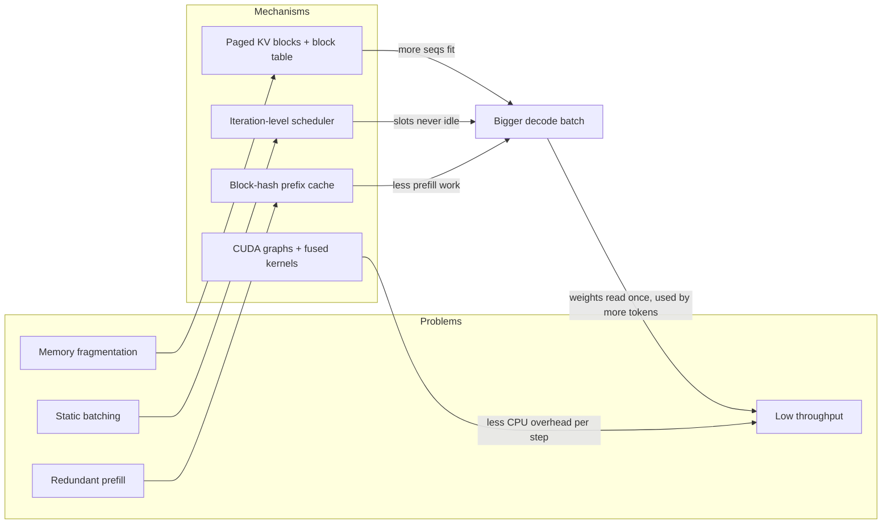

### The physics in one paragraph (with your numbers)

One decode step must read every weight once: about 14.1 GB for Qwen2.5-7B (excluding the
input embedding, as in your ceiling math). At 936 GB/s that alone is ~15 ms. KV for
Qwen2.5-7B is `2 (K,V) × 28 layers × 4 KV heads × 128 dim × 2 bytes = 56 KB per token`. At
batch 64 with an average context of 384 tokens that's ~1.4 GB, about 1.5 ms more. So the
step **cannot** go below ~16.6 ms, and that floor barely moves with batch size until KV
reads catch up with weight reads. That's why tokens/s scales almost linearly with batch in
the memory-bound regime. Every trick in vLLM eventually serves one of two goals:
**raise the batch**, or **get the real step time down toward the floor**.

---

## 1. Architecting inference code with vLLM and HF

### 1.1 What HF gives you vs what vLLM gives you

| Layer | HF `transformers` | vLLM |
|---|---|---|
| Model *config*, tokenizer, chat template, weights | ✅ source of truth (Hub) | **Reuses HF** (`AutoConfig`, `AutoTokenizer`, safetensors from the Hub) |
| Model *forward code* | `modeling_qwen2.py`, written for training + generic inference | **Re-implemented** in `vllm/model_executor/models/qwen2.py`: fused QKV, fused gate/up, paged attention layer, tensor-parallel linear layers. Fallback: `--model-impl transformers` runs HF's code with vLLM's attention. |
| KV cache | `DynamicCache` (grows by `torch.cat`) or `StaticCache` `[B, max_len]` | Global paged block pool shared by every request |
| Batching | Whatever you pass to `generate()`. Static. | Scheduler decides every step |
| Serving | None in the core library (`transformers serve` exists but isn't production-grade) | OpenAI-compatible HTTP server, metrics, health, streaming |

Mental model: **HF is the model zoo and the reference implementation. vLLM is the
runtime.** You use HF to check correctness (same greedy output for the same prompt),
and vLLM for speed.

Do this early: run greedy decoding on 5 prompts in both stacks and diff the token IDs.
They will diverge after some tokens. BF16 kernels differ, and batched vs unbatched math
differs. Learn *where* and *why* they diverge, because "is the output correct?" is the
first question a customer asks.

### 1.2 What an inference server actually is

Strip away the brand names and every LLM server (vLLM, SGLang, TGI, TensorRT-LLM, Triton)
has the same five layers:

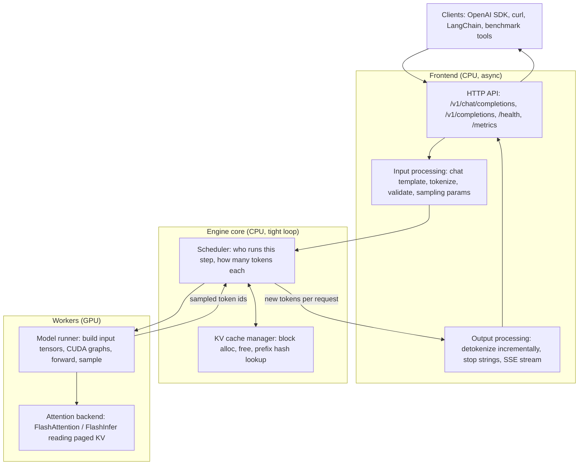

Why split it this way?

- **Frontend vs engine are separate processes in vLLM V1.** Tokenizing, detokenizing and
  HTTP are Python CPU work. If they ran in the same loop as the scheduler they would
  delay the GPU. V1 puts `AsyncLLM` (frontend) and `EngineCore` (busy loop) in separate
  processes, talking over ZMQ. This is the single biggest V1 design decision. Keep it in
  mind when you see GPU idle gaps in a profile.
- **The scheduler is CPU code that decides GPU work.** If one `schedule()` call plus
  input prep takes 3 ms and the forward takes 20 ms, you lose 13% throughput to Python.
  That's why V1 keeps a *persistent batch* (only diffs are applied to GPU input tensors
  each step) and has an optional `--async-scheduling` mode that overlaps step N+1's
  scheduling with step N's GPU work.

### 1.3 Why the OpenAI API became the standard

It isn't because the design is perfect. It's because of network effects plus a few good
properties:

1. **Ecosystem lock-in, the good kind.** The `openai` Python/JS SDKs, LangChain,
   LlamaIndex, eval harnesses, and load generators (`vllm bench serve`, `genai-perf`,
   `guidellm`) all speak it. A server that speaks it gets all of them for free. A
   customer can swap OpenAI → self-hosted vLLM by changing `base_url`.
2. **Messages, not prompts.** `/v1/chat/completions` takes a list of `{role, content}`.
   The **server** applies the model's chat template (from the HF tokenizer config). The
   client never needs to know Qwen uses `<|im_start|>`. This puts model-specific formatting
   on the side that knows the model.
3. **Stateless.** Each request carries its full context. Any replica can serve any
   request, so load balancing is trivial and nothing is lost if a pod dies. The cost:
   every turn resends and re-prefills the history, **unless the server has prefix
   caching**. So statelessness at the API level is exactly what makes APC (and
   prefix-aware routing across replicas) an important optimization in production.
4. **Streaming via SSE** (`stream: true`). It's simple HTTP and works through proxies.
   One `data: {...}` chunk per token or per group of tokens. TTFT and ITL, as the user
   sees them, are measured on these chunks.
5. **`usage` block** (`prompt_tokens`, `completion_tokens`) is how billing and capacity
   planning count work.

What it *doesn't* express well, and what vLLM adds as extra fields: `ignore_eos`,
`min_tokens`, `top_k`, `repetition_penalty`, guided/structured decoding, `priority`,
LoRA adapter selection via the `model` name. You'll need `ignore_eos` (or
`min_tokens`) for P2 to match Phase 1's forced OSL.

### 1.4 Sequence: one streaming chat request through `vllm serve`

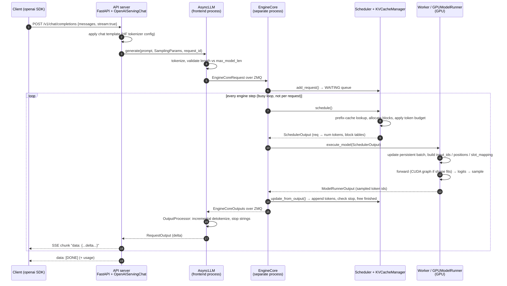

Notice that steps 7–15 run **once per step for the whole batch**, not once per request.
One forward produces one new token for every running request (more if chunked prefill or
speculative decoding is involved).

### 1.5 LLD: the V1 core classes

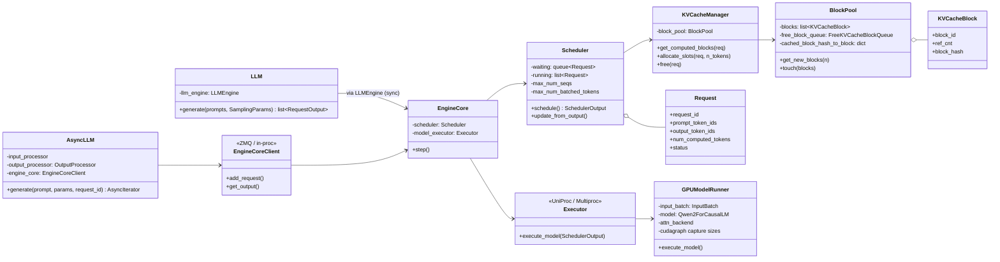

Where to look (grep if moved):

| Class | File (V1) |
|---|---|
| `LLM` | `vllm/entrypoints/llm.py` |
| OpenAI server | `vllm/entrypoints/openai/api_server.py`, `chat_completion/serving.py` + `protocol.py` |
| `AsyncLLM`, `LLMEngine`, `EngineCore`, `OutputProcessor` | `vllm/v1/engine/` |
| `Scheduler` | `vllm/v1/core/sched/scheduler.py` |
| `KVCacheManager`, `BlockPool`, hashing | `vllm/v1/core/kv_cache_manager.py`, `block_pool.py`, `kv_cache_utils.py` |
| `GPUModelRunner`, `InputBatch`, worker | `vllm/v1/worker/gpu_model_runner.py`, `gpu_input_batch.py`, `gpu_worker.py` |
| Attention backends | `vllm/v1/attention/backends/` |
| Qwen2 model | `vllm/model_executor/models/qwen2.py` |

### 1.6 The idea that unlocks the V1 scheduler

V1 has **no separate "prefill phase" and "decode phase"**. Each request has two numbers:

- `num_tokens`: prompt + generated so far
- `num_computed_tokens`: how many of those already have KV in the cache

Every step, the scheduler hands out a **token budget** (`max_num_batched_tokens`) and gives
each request some tokens to close the gap. A new request with a 128-token prompt is
128 behind (prefill). A running request is 1 behind (decode). A long prompt that doesn't fit
the budget gets *part* of its gap this step (chunked prefill). A prefix-cache hit simply
starts `num_computed_tokens` above zero. Prefill, decode, chunked prefill and prefix caching
all collapse into one rule. Read `schedule()` with this in mind and it gets short.

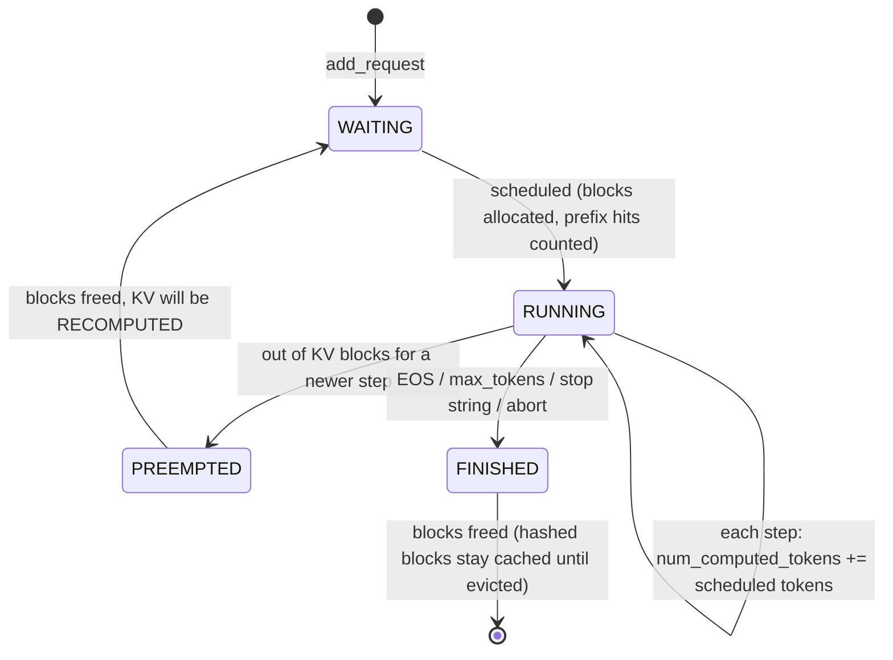

### 1.7 One engine step at the KV-block level

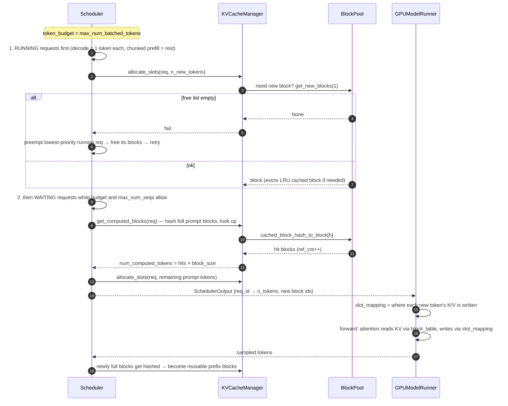

### 1.8 How to structure *your* P2 code

Reuse what Phase 1 already has. The design rule: **the harness (run dir, recorder, summary)
stays identical, and only the "engine" behind it changes.** That's what keeps P1 and P2
comparable.

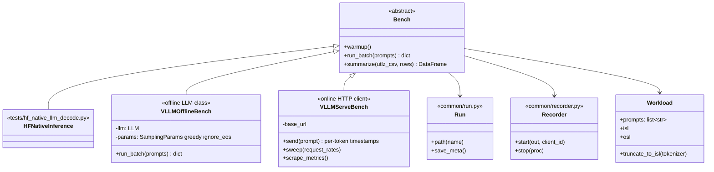

Design notes:

- **Offline (`LLM`) for the apples-to-apples Phase 1 comparison.** Pass the same 64
  prompts, `max_num_seqs=64`, `SamplingParams(temperature=0, max_tokens=512,
  ignore_eos=True)`. Pre-truncate prompts to exactly 128 tokens yourself and pass token
  IDs, so vLLM's tokenization can't change the ISL.
- **Online (`vllm serve` + your client) for latency.** `LLM.generate()` returns when
  everything finishes, so you get no per-token timestamps. TTFT/ITL as a user sees them
  come from a streaming client that timestamps each SSE chunk with `time.time()`, which
  is the same clock your `TokenClock` used and lines up with utlz's `t_server`.
- **Separate venv.** vLLM pins an exact torch version. Your box runs
  `torch 2.14.1+cu130`. Installing vLLM into `/workspace/venv` will silently swap torch
  under Phase 1. Make `/workspace/venv-vllm`, add `requirements/vllm.txt`, and let
  `pip_freeze.txt` in every run dir prove which stack ran.
- **Record vLLM's config in `meta.json`**: version, `gpu_memory_utilization`,
  `max_model_len`, `max_num_seqs`, `max_num_batched_tokens`, `enable_prefix_caching`,
  `enforce_eager`, attention backend, block size, and the KV capacity line from the
  startup log (next section). Without these, a result can't be reproduced.

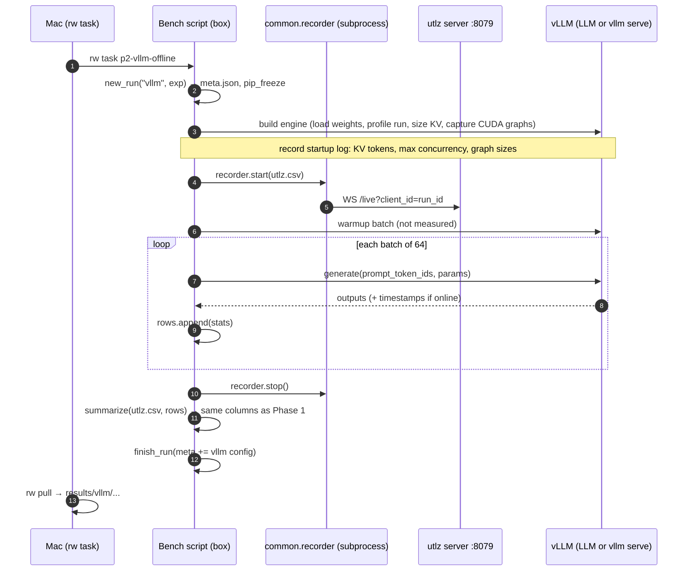

### 1.8.1 Cold-start skeleton

These are starter templates. The plumbing is filled in and copies Phase 1's patterns
(run dir, recorder, `finally` block, signal handling). The parts that teach you something
are left as `TODO(you)`, each with the question you should answer before writing it.
Nothing below has been run, so treat every vLLM API call as "check against your installed
version".

**Layout**

```
utlz-lab/
├── requirements/vllm.txt            NEW  separate venv; does NOT include base.txt
├── setup/setup_vllm.sh              NEW  builds /workspace/venv-vllm
├── common/
│   ├── workload.py                  NEW  prompts → exact-ISL token ids (shared by every phase)
│   └── bench.py                     NEW  Bench base: run dir, recorder, measured loop, summary
├── tests/
│   ├── vllm_offline_decode.py       NEW  E0–E5: LLM class, same harness as Phase 1
│   └── vllm_serve_client.py         NEW  E6–E8: streaming client against `vllm serve`
└── runway-descriptors/
    ├── p2_vllm_offline.toml         NEW
    ├── p2_vllm_server.toml          NEW  background
    └── p2_vllm_client.toml          NEW  load-test client, runs ON THE BOX next to the server
```

**Fill-in order** (each step gives you a result you can check before the next):

| # | File | Done when |
|---|---|---|
| 1 | `requirements/vllm.txt`, `setup/setup_vllm.sh` | both venvs print their own torch version |
| 2 | `common/workload.py` | every row is exactly 128 ids; decoding one row gives readable text |
| 3 | `vllm_offline_decode.py` `run_batch` (throughput only) | E1 end-to-end tok/s for 1 batch |
| 4 | `Bench.summarize` (moved from Phase 1) | `summary.csv` has the same columns as Phase 1 |
| 5 | per-step timing (TTFT/ITL) in offline mode | decode tok/s and step ms comparable to Phase 1 |
| 6 | server descriptor + `vllm_serve_client.py` | rate sweep → `requests.csv` + `vllm_metrics.jsonl` |

#### `requirements/vllm.txt`

```text
# Phase 2 venv (/workspace/venv-vllm), separate from base.txt on purpose:
# vllm pins an exact torch; base.txt's unpinned torch would fight it.
# Pin vllm after the first good install (pip_freeze.txt in every run dir has the version).
vllm
pandas
numpy
pyyaml
websockets    # common/recorder.py
openai        # tests/vllm_serve_client.py (async streaming)
httpx         # /metrics scrape
```

#### `setup/setup_vllm.sh`

```bash
#!/usr/bin/env bash
# Build the Phase 2 venv. Run: rw run "bash setup/setup_vllm.sh"
set -euo pipefail
VENV=/workspace/venv-vllm

[ -x "$VENV/bin/python" ] || python3 -m venv "$VENV"
"$VENV/bin/pip" install -U pip
"$VENV/bin/pip" install -r requirements/vllm.txt

"$VENV/bin/python" - <<'EOF'
import torch, vllm
print("vllm", vllm.__version__, "| torch", torch.__version__, "| cuda", torch.version.cuda)
assert torch.cuda.is_available(), "torch can't see the GPU (driver vs wheel CUDA?)"
EOF

# Checkpoint 1: Phase 1's venv must be untouched
/workspace/venv/bin/python -c "import torch; print('phase1 torch', torch.__version__)"
```

#### Runway descriptors

Runway's `venv = true` activates `/workspace/venv` (Phase 1). For P2, use `venv = false`
and call the vLLM venv's python directly.

```toml
# runway-descriptors/p2_vllm_offline.toml
name = "p2-vllm-offline"
description = "vLLM offline (LLM class), Qwen2.5-7B, ISL 128 / OSL 512, batch 64 — Phase 1 comparison"
run = "/workspace/venv-vllm/bin/python -m tests.vllm_offline_decode --max_num_seqs 64"
venv = false
background = true    # engine startup + graph capture takes a while; follow with rw logs
```

```toml
# runway-descriptors/p2_vllm_server.toml
name = "p2-vllm-server"
description = "vllm serve on :8000 (background). Takes 90% of GPU memory: stop it before offline runs."
run = "mkdir -p /workspace/utlz-out/logs/vllm-server && /workspace/venv-vllm/bin/vllm serve Qwen/Qwen2.5-7B-Instruct --dtype bfloat16 --max-model-len 1024 --max-num-seqs 64 --gpu-memory-utilization 0.90 --no-enable-prefix-caching --host 127.0.0.1 --port 8000 2>&1 | tee /workspace/utlz-out/logs/vllm-server/serve-$(date +%Y%m%d-%H%M%S).log"
venv = false
background = true
push_first = false
```

```toml
# runway-descriptors/p2_vllm_client.toml
# The MEASUREMENT client: runs on the box, next to the server, on purpose (see below).
name = "p2-vllm-client"
description = "Poisson rate sweep against p2-vllm-server; client-side TTFT/ITL + /metrics scrape"
run = "/workspace/venv-vllm/bin/python -m tests.vllm_serve_client --rates 0.5 1 2 4 8 inf --num_requests 200"
venv = false
```

**Why the load-test client runs on the box, not the Mac.** There are two different
"clients" in P2, and they belong in different places:

| | Load-test client (`vllm_serve_client.py`) | Interactive client (OpenAI SDK, curl) |
|---|---|---|
| Purpose | measure the *engine* (E6–E8) | try the API, demo, watch `/metrics` |
| Runs on | the box, via `rw task p2-vllm-client` | your Mac, via tunnel or open port |
| Talks to | `127.0.0.1:8000` | `localhost:8000` (tunnel) or `<ip>:<mapped port>` |

The load-test client lives on the box because the harness assumes it:
- **One clock.** `summarize()` lines up your request timestamps with utlz's `t_server`
  and the `/metrics` scrape. That only works if all of them come from the same machine's
  clock. The Mac's clock is off from the box's by an unknown amount (often tens of ms,
  sometimes seconds), which is bigger than the ITL you're measuring.
- **No network in the numbers.** From the Mac, TTFT and ITL include your Wi-Fi and the
  internet path to Vast. You'd be benchmarking your home network, not vLLM.
- **The harness paths are box paths.** `new_run()` writes to `OUT_BASE=/workspace/utlz-out`,
  `recorder.start()` expects utlz at `127.0.0.1:8079`, and `gpu_snapshot.sh` calls
  `nvidia-smi`. On the Mac, all three need workarounds. On the box they just work, and
  `rw pull` brings the results home like every other phase.

A **separate** experiment worth doing later: run the same script from the Mac to
measure what a remote user really sees, set `OUT_BASE` to a local folder, and compare its
TTFT with the on-box run. The difference is the network's share of the latency. Keep
that result in its own table.

#### Reaching a vLLM server over the network

This works the same for any HTTP server, vLLM included. Nothing here depends on utlz.

**Three conditions for a client to reach a server:**

1. **The server listens on an address the client can reach.** A program *binds* to an
   IP + port. `--host 127.0.0.1` means "only programs on this same machine". `--host 0.0.0.0`
   means "every network card on this machine", so other machines can reach it if step 2
   allows.
2. **The network lets packets through to that port.** Firewalls, cloud security groups
   and NAT port mappings decide which ports are reachable from where. A machine can be
   listening on 8000 and still be unreachable because the network drops the packets.
3. **The client knows the address.** It needs an IP, or a DNS name that resolves to one,
   plus the port.

The IP is the building's address. The port is the door number. Step 1 is whether someone
is behind the door, step 2 is whether the corridor to the door is open, and step 3 is
whether you have the address.

**How production deployments do it.** GPU machines almost never get a public IP. They sit
on a **private network** (addresses like `10.x.x.x`), and vLLM runs there with
`--host 0.0.0.0 --port 8000`. Two kinds of callers reach it:

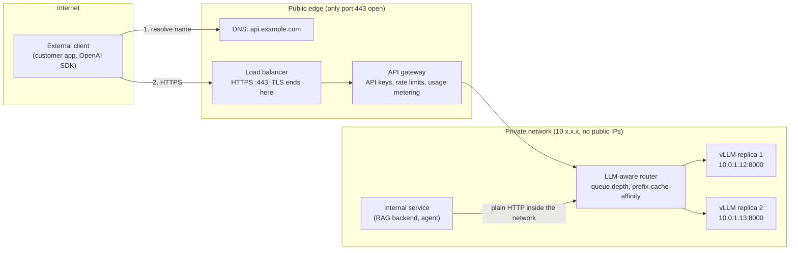

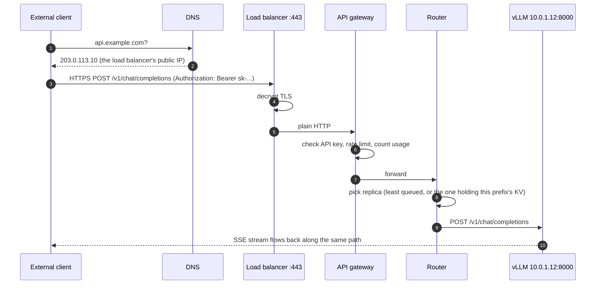

- **Internal services** (a RAG backend, an agent) live on the same private network. They
  call `http://vllm.internal:8000/v1` directly. In Kubernetes that's a *Service* name,
  which gives a stable address in front of the changing pods.
- **External clients** only ever see `https://api.example.com`. Only the load balancer
  has a public IP, and only port 443 is open. The GPU machines aren't reachable from the
  internet at all (condition 2).

Things that are specific to LLM serving here:
- **Readiness takes minutes.** A replica isn't ready until weights are loaded and CUDA
  graphs are captured. The load balancer's health check (`/health`) must keep traffic away
  until then.
- **Streaming through proxies.** Every hop must pass SSE chunks through without
  buffering them, and idle timeouts must be longer than the longest generation. Otherwise
  streams freeze or get cut off.
- **Routing matters more than for normal web apps.** Round-robin ignores that one replica
  may already hold this user's prefix in its KV cache (E7). LLM-aware routers route on
  queue depth and prefix affinity.
- **vLLM's `--api-key` is a single shared key.** Real per-customer auth, quotas and billing
  live in the gateway.

**Your Vast box, option A: the production pattern at small scale.** Vast boxes sit behind
NAT. The public IP `70.30.252.209` is shared, and Vast maps chosen external ports to
ports on your box (that's why SSH is `25365`, not `22`).
1. When you rent the box, ask Vast to open port 8000. The console shows the external port
   it mapped (e.g. `70.30.252.209:41234 → 8000`).
2. Start vLLM with `--host 0.0.0.0 --api-key <secret>`.
3. Point the client at `http://70.30.252.209:41234/v1` with that key.

All three conditions are met. The cost: that port is open to the whole internet, without
TLS, so the API key is mandatory and travels in plain text.

**Your Vast box, option B: the SSH tunnel (lab shortcut).** This is a developer
convenience, not how services are deployed. Keep vLLM on `--host 127.0.0.1`, which is
what the `p2-vllm-server` descriptor does, open no new ports, and borrow the SSH
connection you already have:

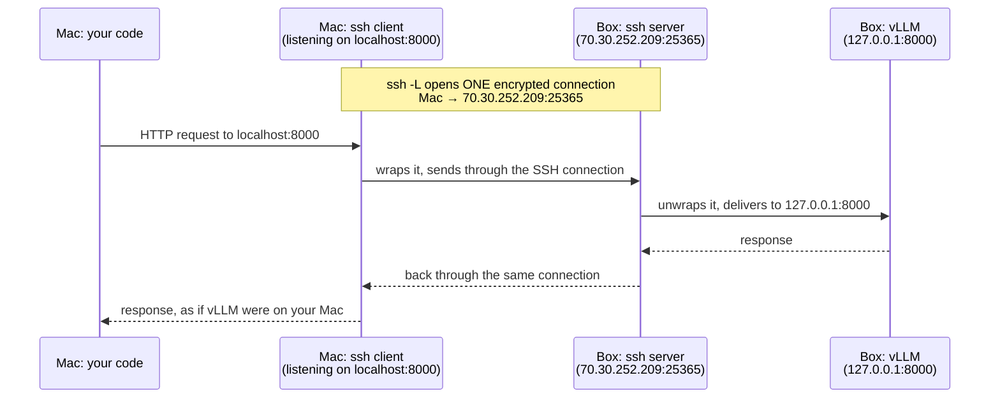

`-L 8000:127.0.0.1:8000` tells the ssh program on your Mac to listen on the Mac's port
8000 and carry anything it receives to `127.0.0.1:8000` on the far side. Condition 1 is
met on the box (vLLM is local to the SSH server), condition 2 is met by the SSH port that
was already open, and condition 3 becomes simply `localhost:8000`.

If you already run a tunnel for something else (this lab's `utlz-tunnel` in `~/.zshrc`
forwards 8079), add `-L 8000:127.0.0.1:8000` to the same ssh command. Otherwise run it on
its own:

```bash
ssh -f -N -p 25365 -o ExitOnForwardFailure=yes -L 8000:127.0.0.1:8000 root@70.30.252.209
```

| | Option A: open port | Option B: SSH tunnel |
|---|---|---|
| Who can reach it | anyone with IP + port (+ key) | only people with SSH access to the box |
| Encryption | none (plain HTTP) | SSH encrypts everything |
| Good for | sharing with a teammate or service, closer to production | your own Mac during the lab |
| Breaks when | you forget `--api-key` | the ssh process dies (`ServerAliveInterval` helps) |

**Check from the client** (option B shown; for option A, swap in the public IP and mapped
port, and pass the key):

```bash
curl -s -o /dev/null -w '%{http_code}\n' http://localhost:8000/health   # 200 once the model is loaded
curl -s http://localhost:8000/v1/models | python3 -m json.tool          # served model name
```

```python
from openai import OpenAI
c = OpenAI(base_url="http://localhost:8000/v1", api_key="EMPTY")
r = c.chat.completions.create(model="Qwen/Qwen2.5-7B-Instruct",
                              messages=[{"role": "user", "content": "hi"}])
print(r.choices[0].message.content)
```

**Benchmark from the box, not the Mac** (reasons above, under the runway descriptors). Measured runs (E6–E8) use `rw task p2-vllm-client`
on the box, calling `127.0.0.1:8000`. That isolates the *engine*. From the Mac, internet
round trip and jitter end up in TTFT and ITL. With option B, all streams also share one SSH
connection, so one slow packet holds up every stream behind it and ITL p99 goes up. Measuring
the full path a real user sees (client → LB → gateway → vLLM) is a separate, valid
experiment. Just don't mix the two in one table.

#### `common/workload.py`

```python
"""Prompts → exact-ISL token ids. Shared by every phase so 'ISL 128' means the same tokens everywhere."""
from __future__ import annotations

from dataclasses import dataclass
from pathlib import Path


@dataclass(frozen=True)
class Workload:
    prompts: list[str]
    token_ids: list[list[int]]   # every row exactly `isl` long
    isl: int
    osl: int


def load_prompts(path: str | Path) -> list[str]:
    with open(path, encoding="utf-8") as f:
        return [line.strip() for line in f if line.strip()]


def build(path: str | Path, tokenizer, isl: int, osl: int) -> Workload:
    prompts = load_prompts(path)
    # TODO(you): tokenize the raw text the way Phase 1 did (no chat template), truncate to isl,
    #   and assert every row has exactly isl ids.
    #   Answer first: does Qwen's tokenizer add a BOS token? When you pass prompt_token_ids,
    #   does vLLM add anything? (Check later: len(out.prompt_token_ids) == isl.)
    token_ids: list[list[int]] = ...
    return Workload(prompts, token_ids, isl, osl)


def batches(seq: list, size: int, drop_last: bool = True):
    """Fixed-size chunks. drop_last=True: a short final batch would be a different experiment."""
    for i in range(0, len(seq), size):
        chunk = seq[i:i + size]
        if drop_last and len(chunk) < size:
            return
        yield chunk
```

#### `common/bench.py`

```python
"""Shared benchmark harness: run dir + utlz recorder + measured loop + summary.

Engine classes implement load / warmup / run_batch / engine_meta. Everything else is shared,
which is what keeps Phase 1 and Phase 2 numbers comparable.
"""
from __future__ import annotations

import abc
import sys
from pathlib import Path

import pandas as pd

from common import recorder
from common.run import finish_run, new_run
from common.workload import Workload, batches

# RTX 3090 DRAM peak, same stand-in as Phase 1. VERIFY.
MEM_BW_PEAK = 936e9
SOL_LAG_S = 1.0


class Bench(abc.ABC):
    phase = "vllm"

    def __init__(self, args):
        self.args = args

    # ---- engine-specific ---------------------------------------------------
    @abc.abstractmethod
    def load(self) -> None:
        """Build the engine and set self.tokenizer. Startup is NOT part of any measured batch."""

    @abc.abstractmethod
    def warmup(self, batch: list[list[int]]) -> None: ...

    @abc.abstractmethod
    def run_batch(self, batch: list[list[int]]) -> dict:
        """One bench.csv row. Must contain t_start, t_end (time.time(), to line up with utlz
        t_server) and t_first_token, which summarize() needs for the decode window."""

    @abc.abstractmethod
    def engine_meta(self) -> dict:
        """Everything needed to reproduce the run: versions + every engine knob + KV capacity."""

    # ---- shared ------------------------------------------------------------
    def summarize(self, utlz_csv: Path, rows: list[dict]) -> pd.DataFrame:
        # TODO(you): move Phase 1's summarize() here (decode-window mask with SOL_LAG_S,
        #   step_ms, ceiling_step_ms, expected_mem_pct, SOL columns). Keep the column names
        #   IDENTICAL to phase1-hf-results.md so the two tables diff cleanly.
        #   bytes_per_decode_step() needs the model config: read it from HF AutoConfig, not
        #   from the vLLM model object (that lives in another process, see gotchas).
        raise NotImplementedError

    def main_loop(self, wl: Workload, exp: str) -> None:
        run = new_run(self.phase, exp, args=vars(self.args))
        rec, rows = None, []
        try:
            run.meta["engine"] = self.engine_meta()
            run.save_meta()
            rec = recorder.start(run.path("utlz.csv"), client_id=run.run_id)

            for i, batch in enumerate(batches(wl.token_ids, self.args.batch_size)):
                if self.args.max_batches is not None and i >= self.args.max_batches:
                    break
                if i == 0:
                    self.warmup(batch)
                row = self.run_batch(batch) | {"batch_idx": i}
                rows.append(row)
                print(f"batch {i}: {row.get('generated_tokens_per_second', 0):.0f} tok/s "
                      f"({row['t_end'] - row['t_start']:.1f}s)", flush=True)
        finally:
            failed = sys.exc_info()[0] is not None
            if rec is not None:
                recorder.stop(rec)
            summary = None
            if rows:
                pd.DataFrame(rows).to_csv(run.path("bench.csv"), index=False)
                if run.path("utlz.csv").exists():
                    summary = self.summarize(run.path("utlz.csv"), rows)
                    summary.to_csv(run.path("summary.csv"), index=False)
                    print(summary.to_string(index=False), flush=True)
            finish_run(
                run,
                failed=failed,
                batches_completed=len(rows),
                summary=None if summary is None else summary.to_dict(orient="records"),
            )
```

#### `tests/vllm_offline_decode.py`

```python
"""Phase 2 / E0–E5: vLLM offline (LLM class) on the Phase 1 workload and harness.

  /workspace/venv-vllm/bin/python -m tests.vllm_offline_decode --max_num_seqs 64
  ... --enforce_eager            # E2
  ... --max_num_seqs 8 --batch_size 8   # E3 sweep point
"""
from __future__ import annotations

import argparse
import signal
import time

import torch   # version only. Do NOT touch torch.cuda in this process (see gotchas).
import vllm
from vllm import LLM, SamplingParams

from common.bench import Bench
from common.workload import build


def _exit_on_signal(signum, frame):
    raise SystemExit(128 + signum)   # unwinds → finally → recorder.stop()


class VLLMOfflineBench(Bench):
    phase = "vllm"

    def load(self) -> None:
        a = self.args
        self.llm = LLM(
            model=a.model_name,
            dtype="bfloat16",
            seed=0,
            gpu_memory_utilization=a.gpu_mem_util,
            max_model_len=a.isl + a.osl,   # TODO(you): predict the "max concurrency" log line first
            max_num_seqs=a.max_num_seqs,
            max_num_batched_tokens=a.max_num_batched_tokens,   # None → vLLM default
            enable_prefix_caching=a.prefix_caching,
            enforce_eager=a.enforce_eager,
        )
        self.tokenizer = self.llm.get_tokenizer()
        self.params = SamplingParams(
            temperature=0.0,      # greedy, as in Phase 1
            max_tokens=a.osl,
            ignore_eos=True,      # same effect as Phase 1's min_new_tokens=osl
        )

    @staticmethod
    def _prompts(batch: list[list[int]]) -> list[dict]:
        return [{"prompt_token_ids": ids} for ids in batch]

    def warmup(self, batch: list[list[int]]) -> None:
        # TODO(you): vLLM captures CUDA graphs at startup. Is a warmup still needed?
        #   Decide from data: time batch 0 vs batch 1 with and without this call.
        short = SamplingParams(temperature=0.0, max_tokens=16, ignore_eos=True)
        self.llm.generate(self._prompts(batch), short, use_tqdm=False)

    def run_batch(self, batch: list[list[int]]) -> dict:
        n, osl = len(batch), self.args.osl
        t_start = time.time()
        outs = self.llm.generate(self._prompts(batch), self.params, use_tqdm=False)
        t_end = time.time()   # generate() blocks until every request is done: no sync needed

        # TODO(you): sanity checks. Every len(o.prompt_token_ids) == isl and every
        #   len(o.outputs[0].token_ids) == osl. Fail loudly, otherwise tok/s is a lie.

        # TODO(you): TTFT / ITL / decode-only tok/s. generate() only gives you end-to-end.
        #   Pick one and write down why:
        #   (a) o.metrics, if your version fills it in (often None in V1; check),
        #   (b) drive the engine yourself: llm.llm_engine.add_request(...) then a
        #       while-loop over llm.llm_engine.step(), timestamping each step.
        #       That gives one timestamp per engine step, the closest match to Phase 1's TokenClock,
        #   (c) leave latency to the online client and report throughput only here.
        t_first_token = ...

        return {
            "batch_size": n,
            "t_start": t_start,
            "t_first_token": t_first_token,
            "t_end": t_end,
            "batch_latency_s": t_end - t_start,
            "generated_tokens_per_second": n * osl / (t_end - t_start),
            # TODO(you): ttft_s, decode_s, decode_tokens_per_second, itl_median_ms, itl_p99_ms
        }

    def engine_meta(self) -> dict:
        a = self.args
        return {
            "engine": "vllm-offline",
            "vllm_version": vllm.__version__,
            "torch_version": torch.__version__,
            "model": a.model_name,
            "gpu_memory_utilization": a.gpu_mem_util,
            "max_model_len": a.isl + a.osl,
            "max_num_seqs": a.max_num_seqs,
            "max_num_batched_tokens": a.max_num_batched_tokens,
            "enable_prefix_caching": a.prefix_caching,
            "enforce_eager": a.enforce_eager,
            # TODO(you): KV capacity (num GPU blocks, tokens), block size, attention backend,
            #   CUDA graph capture sizes. Find where these live under self.llm.llm_engine
            #   (vllm_config / cache_config), or parse them out of the startup log.
        }


def main():
    for sig in (signal.SIGTERM, signal.SIGHUP):
        signal.signal(sig, _exit_on_signal)

    ap = argparse.ArgumentParser(description="vLLM offline decode (Phase 2)")
    ap.add_argument("--model_name", default="Qwen/Qwen2.5-7B-Instruct")
    ap.add_argument("--prompts_path", default="configs/workloads/prompts.txt")
    ap.add_argument("--isl", type=int, default=128)
    ap.add_argument("--osl", type=int, default=512)
    # batch_size = prompts per generate() call (what's SUBMITTED).
    # max_num_seqs = what the scheduler RUNS at once. Equal for E1; they diverge in E4/E5.
    ap.add_argument("--batch_size", type=int, default=64)
    ap.add_argument("--max_num_seqs", type=int, default=64)
    ap.add_argument("--max_num_batched_tokens", type=int, default=None)
    ap.add_argument("--gpu_mem_util", type=float, default=0.90)
    ap.add_argument("--prefix_caching", action="store_true")
    ap.add_argument("--enforce_eager", action="store_true")
    ap.add_argument("--max_batches", type=int, default=None)
    ap.add_argument("--exp", default=None)
    args = ap.parse_args()

    exp = args.exp or f"offline-seqs{args.max_num_seqs}" + ("-eager" if args.enforce_eager else "")

    bench = VLLMOfflineBench(args)
    bench.load()
    wl = build(args.prompts_path, bench.tokenizer, args.isl, args.osl)
    bench.main_loop(wl, exp)


if __name__ == "__main__":   # REQUIRED: vLLM spawns the EngineCore process
    main()
```

#### `tests/vllm_serve_client.py`

```python
"""Phase 2 / E6–E8: streaming client against `vllm serve`. Client-side TTFT/ITL per request.

Server must be running first: rw task p2-vllm-server, then wait for the server to report ready.
  /workspace/venv-vllm/bin/python -m tests.vllm_serve_client --rates 1 2 4 inf --num_requests 200
"""
from __future__ import annotations

import argparse
import asyncio
import json
import random
import time
from dataclasses import dataclass, field

import httpx
import pandas as pd
from openai import AsyncOpenAI
from transformers import AutoTokenizer

from common import recorder
from common.run import finish_run, new_run
from common.workload import build

# Names drift between vLLM versions: curl /metrics once and fix this list.
METRICS_WANTED = (
    "vllm:num_requests_running",
    "vllm:num_requests_waiting",
    "vllm:kv_cache_usage_perc",
    "vllm:num_preemptions_total",
)


@dataclass
class ReqTrace:
    req_idx: int
    rate: float
    t_send: float
    t_chunks: list[float] = field(default_factory=list)   # time.time() per SSE chunk with text
    completion_tokens: int | None = None                  # from the final usage chunk
    error: str | None = None

    def row(self) -> dict:
        # TODO(you): ttft_s = t_chunks[0] - t_send; itl = consecutive diffs; e2e_s; tokens.
        #   Before trusting ITL, answer: is one SSE chunk one token? Compare
        #   len(t_chunks) with completion_tokens. If they differ, why? (Detokenizer
        #   holding back partial UTF-8? Server-side stream batching?)
        ...


async def one_request(client: AsyncOpenAI, model: str, idx: int, rate: float,
                      token_ids: list[int], osl: int) -> ReqTrace:
    tr = ReqTrace(idx, rate, time.time())
    try:
        stream = await client.completions.create(
            model=model,
            prompt=token_ids,          # /v1/completions takes token ids: no chat template, same as Phase 1
            max_tokens=osl,
            temperature=0.0,
            stream=True,
            stream_options={"include_usage": True},
            extra_body={"ignore_eos": True},   # vLLM extension, not in the OpenAI spec
        )
        async for chunk in stream:
            now = time.time()
            if chunk.choices and chunk.choices[0].text:
                tr.t_chunks.append(now)
            if chunk.usage:
                tr.completion_tokens = chunk.usage.completion_tokens
    except Exception as e:   # record and keep going: failures are a result too
        tr.error = repr(e)
    return tr


async def open_loop(client, model, prompts, rate, osl, n) -> list[ReqTrace]:
    """Poisson arrivals at `rate` req/s, sent whether or not earlier ones finished.
    This is what exposes queueing delay (no coordinated omission)."""
    rng = random.Random(0)
    tasks = []
    for i, ids in enumerate(prompts[:n]):
        tasks.append(asyncio.create_task(one_request(client, model, i, rate, ids, osl)))
        if rate != float("inf"):
            await asyncio.sleep(rng.expovariate(rate))
    return await asyncio.gather(*tasks)


async def closed_loop(client, model, prompts, users, osl, n) -> list[ReqTrace]:
    # TODO(you): `users` concurrent workers; each sends its next request only after the
    #   previous one finished. Run both loops on the same server and explain why
    #   closed-loop TTFT p99 looks better than open-loop at the same throughput.
    raise NotImplementedError


async def scrape_metrics(base_url: str, out_path, stop: asyncio.Event, period: float = 0.5):
    """Poll /metrics → JSON lines {t_wall, name: value}, same clock as utlz.csv's t_wall."""
    async with httpx.AsyncClient(timeout=5) as c:
        with open(out_path, "a") as f:
            while not stop.is_set():
                t = time.time()
                text = (await c.get(f"{base_url}/metrics")).text
                # TODO(you): parse Prometheus text lines 'name{labels} value' (skip '#' lines),
                #   keep names in METRICS_WANTED, write {"t_wall": t, ...} as one JSON line.
                ...
                try:
                    await asyncio.wait_for(stop.wait(), timeout=period)
                except asyncio.TimeoutError:
                    pass


async def amain(args):
    tok = AutoTokenizer.from_pretrained(args.model_name)
    wl = build(args.prompts_path, tok, args.isl, args.osl)
    client = AsyncOpenAI(base_url=f"{args.base_url}/v1", api_key="EMPTY",
                         max_retries=0)   # retries would hide failures and distort latency

    run = new_run("vllm", args.exp or "serve-sweep", args=vars(args))
    # TODO(you): put the server's config in run.meta (GET /v1/models + the serve log's
    #   KV capacity line + vllm version). The client can't see engine flags on its own.
    rec = recorder.start(run.path("utlz.csv"), client_id=run.run_id)
    stop = asyncio.Event()
    scraper = asyncio.create_task(scrape_metrics(args.base_url, run.path("vllm_metrics.jsonl"), stop))
    rows: list[dict] = []
    try:
        # TODO(you): one small unmeasured warmup request here
        for rate in args.rates:
            traces = await open_loop(client, args.model_name, wl.token_ids, rate, args.osl, args.num_requests)
            rows += [tr.row() for tr in traces]
            print(f"rate {rate}: {sum(t.error is None for t in traces)}/{len(traces)} ok", flush=True)
            # TODO(you): cool-down. Wait until num_requests_running == 0 before the next rate,
            #   or the next rate's TTFT includes this rate's leftover queue.
    finally:
        stop.set()
        await scraper
        recorder.stop(rec)
        if rows:
            pd.DataFrame(rows).to_csv(run.path("requests.csv"), index=False)
        finish_run(run, requests=len(rows))


def main():
    ap = argparse.ArgumentParser(description="vLLM serve streaming client (Phase 2)")
    ap.add_argument("--base_url", default="http://127.0.0.1:8000")
    ap.add_argument("--model_name", default="Qwen/Qwen2.5-7B-Instruct")   # must match the served name
    ap.add_argument("--prompts_path", default="configs/workloads/prompts.txt")
    ap.add_argument("--isl", type=int, default=128)
    ap.add_argument("--osl", type=int, default=512)
    ap.add_argument("--rates", type=float, nargs="+", default=[1.0])     # "inf" parses to float('inf')
    ap.add_argument("--num_requests", type=int, default=200)
    ap.add_argument("--exp", default=None)
    asyncio.run(amain(ap.parse_args()))


if __name__ == "__main__":
    main()
```

#### Gotchas the skeleton is built around

| Gotcha | Why | What the skeleton does |
|---|---|---|
| `if __name__ == "__main__":` is mandatory | V1 starts `EngineCore` in a child process; without the guard the child re-runs your script | guard in both scripts |
| Don't call `torch.cuda.*` in the bench process | The GPU work happens in the EngineCore process. `torch.cuda.synchronize()` here syncs nothing and creates a second CUDA context (hundreds of MB taken from KV) | timing relies on `generate()` blocking; `torch` imported for its version only |
| Model config for `bytes_per_decode_step` | `llm` doesn't hold the model in your process | read `AutoConfig` in `summarize()` |
| `venv = false` in descriptors | runway's `venv = true` activates the Phase 1 venv | absolute path to `/workspace/venv-vllm/bin/python` |
| Server and offline runs can't share the GPU | each preallocates 90% of memory | stop `p2-vllm-server` before `p2-vllm-offline` |
| Orphaned EngineCore after a kill | a hard kill on the parent can leave the child holding GPU memory | after `rw stop`, check `nvidia-smi` for stray python processes |
| `max_retries=0` on the client | the SDK retries silently by default, which turns errors into long latencies | set explicitly |
| Empty-text SSE chunks | the incremental detokenizer can hold back partial characters | only chunks with text are timestamped; reconcile with `usage` (TODO) |
| `batch_size` ≠ `max_num_seqs` | submitted vs running at once | two separate flags |

### 1.9 Cold-start ladder: from `Trainer` to `EngineCore`

You already know how a PyTorch training codebase is put together. A vLLM runtime is the
same shape with three changes. Learn the changes, not a whole new architecture.

| You know (training) | vLLM equivalent | What's different |
|---|---|---|
| `nn.Module` | `Qwen2ForCausalLM` in `models/qwen2.py` | still an `nn.Module`. Fused layers, and `load_weights()` maps HF tensor names onto them |
| `Dataset` | the request queue (`Scheduler.waiting`) | items arrive over time, not all up front |
| `DataLoader` + `collate_fn` | `Scheduler.schedule()` + `GPUModelRunner._prepare_inputs()` | **re-run every step**, batch membership changes every step, sequences are **packed, not padded** |
| `Trainer.fit()` loop | `EngineCore.step()` busy loop | forward + sample instead of forward + backward |
| optimizer state / buffers | **KV cache** (`BlockPool`) | state that lives across steps, owned by the runtime, not the model |
| `Accelerator` / DDP strategy | `Executor` → `Worker` | tensor parallel instead of data parallel |
| callbacks / loggers | `OutputProcessor`, `/metrics` | runs in a different process from the loop |

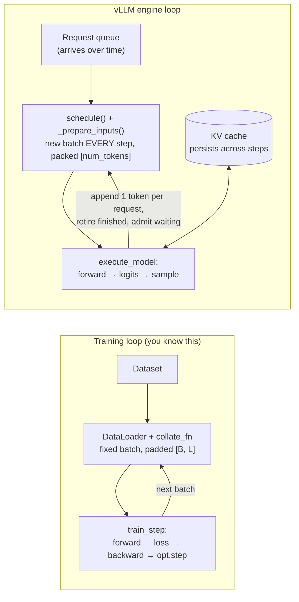

The single biggest shift: **there is no batch dimension.** `input_ids` is 1-D,
`[total tokens scheduled this step]`, with all requests concatenated. Where each request
starts and ends travels separately in *attention metadata* (`query_start_loc`,
`seq_lens`, block tables), which the model reads from a forward context, not from its
`forward()` arguments. Once that clicks, the model file reads like any `nn.Module`.

**The ladder.** Time-box each rung. If you're stuck past the box, ask a specific
question (what you tried, what you expected, what you saw). Hints come in levels:
a nudge → a file and line → a snippet. Never the whole thing.

| Rung | Do | Time box | You've got it when you can say… |
|---|---|---|---|
| 1 | Offline `LLM.generate` on 4 prompts. Read the whole startup log, line by line | 30 min | what each startup phase did, and the KV token count |
| 2 | Same script with `VLLM_ENABLE_V1_MULTIPROCESSING=0` (engine in your process, so breakpoints work) and `enforce_eager=True`. Run it in an interactive `ssh` session (pdb needs a terminal; `rw task` doesn't have one, VS Code Remote-SSH works too). Breakpoints in `Scheduler.schedule`, `GPUModelRunner.execute_model`, `Qwen2Model.forward` | 2 h | the shapes of `input_ids` / `positions` at the prefill step vs a decode step, and why |
| 3 | Turn CUDA graphs back on (drop `enforce_eager`). Does your breakpoint in `Qwen2Model.forward` still hit during decode? | 30 min | why not, and what that tells you about where Python overhead went |
| 4 | Read `models/qwen2.py` next to HF `modeling_qwen2.py`. Explain `stacked_params_mapping` in `load_weights()` | 2 h | how HF's separate `q_proj/k_proj/v_proj` weights end up in one `qkv_proj` |
| 5 | Replace `llm.generate()` with your own loop: `llm.llm_engine.add_request(...)`, then `while has_unfinished_requests(): step()` with a timestamp per step | 2 h | this is your `Trainer.fit()`. It also fills the TTFT/ITL `TODO` in the offline bench |
| 6 | §1.8.1 fill-in order, steps 1–6 | 1–2 days | E1 row in the results doc |
| 7 | E9: the nano-scheduler on top of HF | 2–3 days | it matches vLLM's greedy output, and you can name each reason it's slower |

Rungs 2–5 are what turn "I've used vLLM" into "I know where the time goes in vLLM". Don't skip
them to get to the benchmark faster.


---

## 2. Going beyond the docs

The docs tell you which knobs exist. An inference engineer knows **what each knob costs,
can predict the number before running it, and can explain a miss.** Every exercise below
follows one loop:

> **Predict** (write the number down first) → **Run** → **Measure** (utlz + vLLM metrics
> + your own timestamps) → **Explain the gap** → **Read the code path that caused it.**

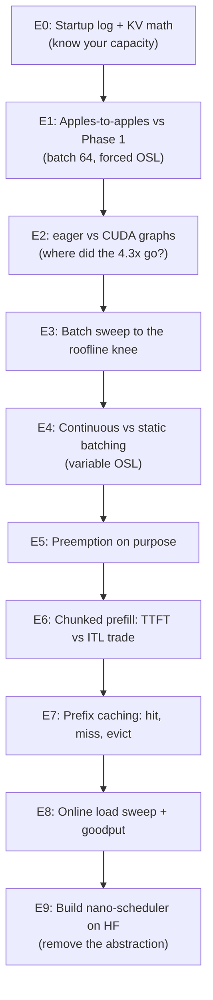

### E0. Read the startup log like a capacity planner

At startup vLLM loads weights, runs a **profile pass** with a dummy batch of
`max_num_batched_tokens`, measures peak activation memory, then gives the rest (up to
`gpu_memory_utilization × total`) to the KV block pool. It logs something like
`Available KV cache memory: X GiB`, `GPU KV cache size: N tokens`,
`Maximum concurrency for L tokens per request: C×`.

**Predict first.** 3090 = 24 GiB. × 0.9 = 21.6. Weights ≈ 15.2 GB (≈14.2 GiB). Activations
+ CUDA graphs + non-torch ≈ 1–2 GiB. So KV ≈ 5–6 GiB. At 56 KB/token that's ~100k tokens,
or ~160 concurrent sequences of 640 tokens. Then check your number against the log, and
explain any gap of more than 10%.

Things to see for yourself:
- `nvidia-smi` shows ~90% memory used **before any request arrives**. vLLM preallocates
  the whole pool. "Memory used" is meaningless for vLLM; `vllm:kv_cache_usage_perc`
  is the real occupancy. Customers will ask about this.
- Change `max_model_len` (default 32768 for Qwen2.5) to 1024. KV size barely changes, but
  the "max concurrency" line does. Why? (It's computed per max-length request.)
- Change `max_num_batched_tokens`. The profile pass gets bigger, and KV gets smaller.

### E1. Apples-to-apples with Phase 1

Same 64 prompts, ISL 128 (token IDs), OSL 512 with `ignore_eos`, greedy,
`max_num_seqs=64`, prefix caching **off** for this run (your prompts were designed not to
share prefixes, but be explicit).

**Predict:** if vLLM gets to ~80% of DRAM peak, step ≈ 16.6 / 0.8 ≈ 21 ms, so decode
≈ 64 / 0.021 ≈ 3,000 tok/s, about 3.4× HF eager. Memory SOL should rise toward 80–90%.

Then explain the gap from 71.6 ms down to ~21 ms. It's spread across:
- Python/launch overhead (hundreds of small kernels per step × 28 layers)
- HF `DynamicCache` growth (`torch.cat` every step copies KV)
- unfused QKV and gate/up projections (more kernels, more reads)
- SDPA over padded `[B, L]` tensors vs FlashAttention over packed varlen sequences

E2 and a profiler split this out.

### E2. Eager vs CUDA graphs: find where the time went

Run E1 with `enforce_eager=True` and again with the default (CUDA graphs on).

- Capture a short torch profile (vLLM supports this via the `VLLM_TORCH_PROFILER_DIR`
  env var and `/start_profile` / `/stop_profile` on the server). Or use
  `nsys profile` on the offline script.
- In the trace, look at the **gaps between kernels** in eager mode. That's CPU time
  where the GPU waits. With graphs on, one decode step should be one dense block.
- Compare with your Phase 1 static+compile result, which got *slower* (78 ms vs 72 ms)
  even with CUDA graphs. vLLM's graphs win and HF's didn't. Find the reason from the two
  traces: kernel choice, padding, whether attention is inside the graph (vLLM captures
  piecewise or full graphs depending on version and backend). That answer is a strong
  interview-grade insight.
- CUDA graphs are captured for a fixed list of batch sizes. A batch of 37 is padded up to
  the next captured size. Find that list in the log, then run batch 33 vs 32 and measure
  the padding cost.

### E3. Batch sweep: find the roofline knee

Sweep `max_num_seqs` ∈ {1, 2, 4, 8, 16, 32, 64, 128, 160} (forced OSL, offline).
Plot step ms, decode tok/s, memory SOL, compute SOL.

**Predict:** step ms stays nearly flat (~17–20 ms) while tok/s grows almost linearly. Then
KV reads and attention grow, compute SOL rises, and the curve bends. Find the batch where
step time has grown by 25% over batch 1. That's the "knee" past which you're trading
latency for throughput. This chart is the core of most capacity conversations. Compute
the expected bytes per step (you already have `bytes_per_decode_step()`) and overlay it.

### E4. Continuous batching vs static batching (make the waste visible)

Phase 1 forced every request to exactly 512 tokens, which **hides** the static-batching
problem. Make a variable-OSL workload: sample `max_tokens` per request from a long-tailed
distribution (e.g. lognormal, median 150, p99 900).

- HF static batch: each batch runs to its max. Count **wasted slot-steps** = Σ over
  batches of (max_len − len_i) for each row. That's padding work the GPU did for nothing.
- vLLM: submit all requests at once with `max_num_seqs=64`. Plot
  `num_requests_running` over time (scrape `/metrics`, or log from a custom loop using
  `LLMEngine.step()`). It should stay pinned at 64 until the queue drains.
- Report: useful tokens/s for both. The ratio is what continuous batching is worth *for
  this length distribution*. Change the distribution and the answer changes. That's the
  real lesson: the gain depends on the variance of output length.

### E5. Cause preemption on purpose

Set `gpu_memory_utilization` low (e.g. 0.75, so KV is tiny) and `max_num_seqs=256` with
long OSL. The scheduler admits requests optimistically. As they grow, blocks run out.

- Watch `vllm:num_preemptions` (name varies, so grep `/metrics`) and the warning in the log.
- V1 preempts by **recompute**: it throws away the victim's KV and re-prefills it later.
  Measure the throughput collapse and the TTFT/E2E of preempted requests.
- Then lower `max_num_seqs` until preemptions stop. Throughput usually goes **up**. The
  lesson: admission control beats over-admission.
- Read the preemption branch in `Scheduler.schedule()` and find which request gets picked
  as the victim.

### E6. Chunked prefill: the TTFT vs ITL trade-off

Online server, steady decode load (say 48 running streams), then inject a few 4k-token
prompts.

- With a large `max_num_batched_tokens` (e.g. 8192), a long prefill fits into one step.
  That step is slow, and **every running stream gets an ITL spike**. Watch ITL p99.
- With a small budget (e.g. 512), the prefill is chunked over several steps. ITL stays
  smooth, and TTFT for the long prompt goes up.
- Plot ITL p99 vs TTFT across budgets. You're choosing a point on a curve, and the right
  point depends on the product (chatbot vs batch summarization). This is the kind of
  trade-off you'll be asked to recommend.

### E7. Prefix caching: hits, misses, eviction

Your `make_prompts.py` deliberately avoids shared prefixes. Now break that on purpose:

1. **Shared system prompt:** prepend the same 1,024-token system prompt to every request.
   With APC off vs on, compare TTFT and prefill throughput. Check the hit counters
   (`vllm:prefix_cache_hits` / `queries`, or similar).
2. **Block boundary effect:** use a shared prefix of 1,000 tokens vs 1,008 tokens
   (block size 16). Only **full** blocks are cached. Predict the hit count for each.
3. **Multi-turn chat:** simulate 20 users × 10 turns through `/v1/chat/completions`,
   resending the history each turn. Measure TTFT per turn index. With APC, TTFT should
   stay flat. Without it, TTFT grows with history length.
4. **Eviction:** add enough unrelated traffic to fill KV, then send turn 11. The prefix
   is gone (LRU evicted) and TTFT jumps back. This is exactly why multi-replica
   deployments need **prefix-aware routing** (send a user to the replica that has their
   blocks). Write down how you'd design that router.
5. **Sampling vs caching:** does changing `temperature` invalidate the cache? (No. KV
   depends only on tokens.) Does a LoRA adapter? (Yes. It's part of the block hash's
   extra keys.) Confirm both in `kv_cache_utils.py`.

### E8. Online load test: throughput is not the metric, goodput is

- Use `vllm bench serve` (random dataset, ISL 128, OSL 512, `--ignore-eos`) with a
  **Poisson request rate** sweep: 0.5, 1, 2, 4, 8 req/s, ∞.
- Plot TTFT p50/p99 and ITL p50/p99 vs request rate. Find the saturation knee where
  the waiting queue starts growing without bound.
- Define an SLO (e.g. TTFT p99 < 1 s, ITL p99 < 50 ms). **Goodput** = requests/s that meet
  it. Max goodput is the number a customer actually buys.
- Know the trap: a **closed-loop** benchmark (N clients, each waits for its reply) can't
  overload the server and hides queueing delay (coordinated omission). An **open-loop**
  one (fixed arrival rate) shows it. Know which one any benchmark you're shown is using.
- Line up utlz SOL against `num_requests_running` over time: SOL should track batch size,
  not request rate.

### E9. Remove the abstraction: build a nano-scheduler on top of HF

This is the exercise that turns "I read about it" into "I know it". In ~300–500 lines,
on top of the HF Qwen2 model you already load:

1. A `BlockPool` with a free list and `block_size=16`, backed by one big KV tensor
   `[num_blocks, 2, layers, block_size, kv_heads, head_dim]`.
2. Per-request block tables. Write new K/V via a slot mapping.
3. An attention call that reads paged KV. Start the simple way: gather blocks into a
   contiguous tensor and call SDPA (slow but correct). Then try FlashAttention's or
   FlashInfer's paged API.
4. A `step()` loop: admit waiting requests under a token budget, run one forward over
   packed sequences, sample, retire finished requests.
5. Then add block-hash prefix caching.

Check against vLLM greedy outputs. Then profile it and see *why* it's slower than vLLM.
Each slowdown you find matches a vLLM design decision you can now explain: persistent
batch, CUDA graphs, separate engine process, fused kernels. Reading reference:
**nano-vllm** (a ~1.2k-line reimplementation of the vLLM core) is well worth an
evening before you start.

### Code-reading path (one evening each)

1. `LLM.generate` → `LLMEngine` → `EngineCore.step`: follow one request end to end with a
   debugger, offline mode, `enforce_eager=True`, one prompt.
2. `Scheduler.schedule()`: read it with the `num_computed_tokens` model from §1.6.
   Annotate every branch.
3. `KVCacheManager` + `BlockPool` + `kv_cache_utils.hash_block_tokens`: draw the free
   list and hash map for a 3-request example on paper.
4. `GPUModelRunner.execute_model` + `_prepare_inputs`: what are `slot_mapping`,
   `query_start_loc`, `seq_lens`, and why are sequences packed instead of padded?
5. `models/qwen2.py` side by side with HF `modeling_qwen2.py`: list every fusion and
   layer swap (`QKVParallelLinear`, `MergedColumnParallelLinear`, `RMSNorm` fused with
   residual add, the `Attention` layer).

### Habits that separate you from a docs-level user

- **Always state the bound.** Before you say "vLLM is fast here", say whether the step is
  memory-, compute-, or CPU-bound, and back it with a number (utlz SOL, or a trace gap).
- **Separate engine time from client time.** Server-side metrics (`/metrics` histograms)
  vs client-side SSE timestamps differ by network + detokenize + queueing. Know both.
- **One knob per run, config in `meta.json`.** You already do this. Keep it up.
- **Warmup is not optional.** First requests include CUDA graph capture, allocator growth
  and (for `torch.compile`) compilation. vLLM does most of this at startup, but measure
  to confirm it.
- **Read the logs at startup**, every time: attention backend picked, CUDA graph sizes,
  KV tokens, any "falling back to …" warnings. A silent fallback (e.g. to a slower
  attention backend on Ampere, since FA3 is Hopper-only) changes every number after it.
- **Know what utlz needs from vLLM.** The onboarding notes say attainable SOL needs
  vLLM + a supported model on H100/A100. On the 3090 you'll get SOL but not ceilings.
  Find out what utlz reads from vLLM to compute them. That's where this lab connects to
  the product.

---

## Suggested P2 checkpoints

| # | Done when |
|---|---|
| 1 | `/workspace/venv-vllm` exists, Phase 1 venv untouched (`torch.__version__` unchanged) |
| 2 | E0: startup-log KV numbers within 10% of your hand math, written down |
| 3 | E1 result row in `docs/phase2-vllm-results.md`, same columns as Phase 1 |
| 4 | E2: one sentence, backed by a trace, on where HF's extra ~50 ms/step goes |
| 5 | E3 chart + knee batch size |
| 6 | E4–E7: one table each, with prediction vs measured |
| 7 | E8 goodput number for a stated SLO |
| 8 | E9 nano-scheduler matches vLLM greedy output on 5 prompts |
